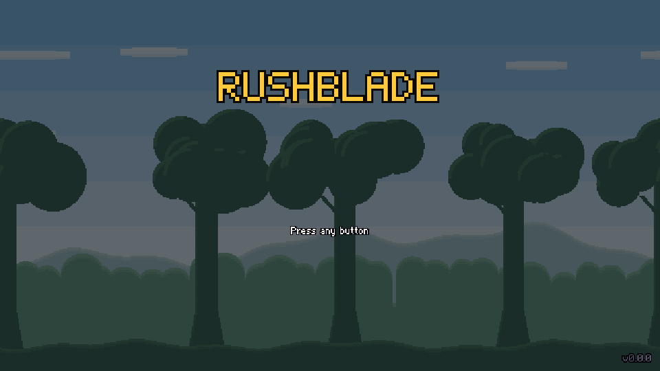

# RUSHBLADE review, November 2026

An independent review of the whole project from four sides: code, gameplay, phone and app, and marketing. Written for the designer, in plain words.

**Tags:** each item is **Quick** (an hour or so), **Medium** (about a day) or **Big** (a milestone).
**Who:** each item says which chat it belongs to: *builder*, *design* or *art*.
**Messages to paste into each chat:** [`MESSAGES-2026-11.md`](MESSAGES-2026-11.md).

---

## How I reviewed, and what I could not check

- Ran every check: install, typecheck, unit tests, build, browser tests.
- Played with a scripted browser on a desktop screen (1280 × 720) and on emulated phones (667 × 375, 844 × 390, 932 × 430), a tablet (1024 × 768) and portrait. I went through the title screen, "Make your hero", the Home Village, class pick, all 19 Training Yard stations, the start of Stage 1, the Great Boar fight, the stat pick, pause and loadout, Daily, leaderboard and Boss Rush setup.
- Wrote a small play-bot that fights through Stage 1 with every starting kit, to put numbers on difficulty.
- Read the code for saving, the game loop, touch controls, the offline copy, updates and the leaderboard.
- Measured download size and the cost of game logic and drawing with the processor slowed 4×.

**Not checked, so treat with care:**

- **The live site.** This environment cannot reach `raaxxaa.github.io` (the network blocks it). Everything here is from a local build of `main`.
- **A real phone.** Phone results are from emulation. The emulated browser draws without a graphics chip, so I can measure how much work the game does, not real frames per second.
- **Stages 2 to 4 by hand.** The automated tests cover them (every enemy, both roads, all bosses, a full run to the King). I played Stage 1 and the first boss myself.
- **Sound and music.** I could not listen.
- **Name clashes.** I did not search stores for other games called "Rushblade" (see section 4).

---

## Check results

| Check | Result |
|---|---|
| `npm install` | OK, 0 known vulnerabilities |
| `npm run typecheck` | Pass |
| `npm test` | Pass: 1,844 tests in 223 files (38 s). With my fixes: 1,853 in 226 |
| `npm run build` | Pass. One warning: the game code is a single 2.1 MB file (587 KB compressed) |
| `npm run test:e2e` | 255 of 256 passed. The one failure (`phone.spec.ts` "Training Yard stations 1 to 3 by touch") passed when run again on a quiet machine. It uses real-time waits and failed while I was running other heavy work, so it is a fragile test, not a game bug |
| After my fixes | Typecheck, unit tests (1,853) and build pass. Full browser run: **256 of 256 passed** (13.7 min) |

---

## Top 10: what would help the game most, for the effort

| # | What | Why it matters | Effort | Who |
|---|---|---|---|---|
| 1 | **Merge the fix branch** (4 small fixes) | On phones the tutorial told players to press keyboard keys, hints showed empty boxes, the game could fail to start offline, and some updates would never arrive | Quick | builder |
| 2 | **Fix the first 60 seconds** | A new player gets a character creator before any play, then a village with no instruction at all. Nothing says "walk to a statue and press E" until they hit the gate | Quick | design, builder |
| 3 | **Make the Daily short** | The leaderboard only takes your *first* attempt of the day and only if you *finish all 4 stages*. A new player will not appear on it for weeks. The Daily is your best marketing hook and almost nobody can use it | Medium | design |
| 4 | **Shrink the first download** | The whole game (27 MB, 633 files) loads before the title screen. About 15 MB of that really travels over the network, 11 MB of it uncompressed sound. Then the offline copy fetches everything a second time | Medium | builder, art |
| 5 | **Rework the touch layout** | On a phone the buttons sit on the right third of the picture, which is exactly where enemies come from. On 16:9 phones the pause button covers part of the HUD | Medium | design, builder |
| 6 | **Keep cheats out of records** | Adding `?debug=1` to the live address gives anyone teleport and kill-all, and those runs still set records and go to the online leaderboard | Quick | builder |
| 7 | **Protect saves on iPhone** | Safari can wipe a website's saved data after 7 days without a visit. The game never asks the browser to keep it | Quick | builder |
| 8 | **Make hints readable** | The tutorial line is the smallest text on screen, sits at the very bottom far from the hero, and shares the spot with "Tap for sound" | Quick | design, art |
| 9 | **Cut the swamp's drawing cost, then test on a real phone** | The darkness effect is redrawn dot by dot on the processor every frame. With a phone-speed processor it alone takes longer than a whole frame should | Medium | builder |
| 10 | **Build the launch kit** | No story reason for the hurry, no names, no logo, no trailer, no page description for link previews, and the title still says v0.0.0 | Medium | design, art |

---

## 1. Code health

### What is good

- **The checks are strong.** 1,844 unit tests and 256 browser tests, all green. The test code is two thirds the size of the game code. That is rare for a project this young.
- **The rules are cleanly separated.** `src/core/` has no Phaser imports (I checked), no `Math.random()`, and runs at a fixed 120 steps a second. This is why seeds, ghosts, fair timing and my play-bot all work. It is the single best technical decision in the project.
- **Saves are careful.** Each write keeps a backup, a broken save is set aside instead of deleted, a save from a newer version is never overwritten, and there is an export code (`src/game/save/storage.ts`).
- **Game speed stays honest.** I slowed the processor 4× and the frame rate fell to about 16 a second; the game still ran its full 120 steps a second. A slow phone drops frames but does not turn into slow motion.
- **The game logic is cheap.** One step costs about 0.15 ms on this machine and about 1 ms with a phone-speed processor. Logic is not what will slow a phone.

### Findings

**C1. Cheat tools work on the live game and count for records.** *Quick, builder.*
- Where: `src/game/debug.ts` (`debugEnabled`), `src/game/online/leaderboard.ts`.
- What: any build opened with `?debug=1` exposes `window.__game`, which can teleport, kill everything and set health. Nothing marks such a run, so it can set personal bests and post to the Daily leaderboard.
- Why it matters: one screenshot of an impossible time on the leaderboard and the hook is dead.
- What to do: when debug is on, mark the run (like assist does) so it writes no records and sends nothing. Keep `?debug=1` for testing.

**C2. The leaderboard trusts whatever it is sent.** *Quick now, Big later, builder and design.*
- Where: spec 06 §14.3 says so openly ("It's meant for friends").
- What: the public key lets anyone post any name and time above 50 seconds. There is no word filter on names.
- What to do now: add a floor per day that is closer to a real time, and a simple blocked-word list. Later: store the run's inputs with the score and replay them to check (the fixed-step design makes this possible, which most games cannot do).

**C3. Saves can vanish on iPhone browsers.** *Quick, builder.*
- Where: `src/game/save/storage.ts` (only `localStorage`).
- What: Safari removes a site's stored data after 7 days without a visit, unless the site is on the home screen. The game never calls `navigator.storage.persist()`. Inside the iPhone app, iOS can also clear this storage when the phone is low on space.
- What to do: ask for persistent storage on first save; in the app, also write the save with Capacitor's own storage. Show the export code more prominently.

**C4. No message when something crashes.** *Quick, builder.*
- Where: `src/main.ts` (no `error` or `unhandledrejection` handler anywhere in `src/`).
- What: if the game throws, the player sees a frozen picture and you never hear about it.
- What to do: a plain "Something went wrong, tap to reload" panel that also shows the error text so players can send it to you.

**C5. The swamp darkness is drawn on the processor.** *Medium, builder.*
- Where: `src/game/view/darkness.ts`.
- What: every frame the camera moves, a 640 × 360 mask is recalculated dot by dot and uploaded as a new picture. With the processor slowed 4× the drawing code took 20 ms on average in the swamp (34 ms at worst), against 5 ms in the plains. A frame should take under 16 ms in total.
- What to do: draw each light as a ready-made soft circle and let the graphics chip combine them.

**C6. Browser tests are not run automatically.** *Quick, builder.*
- Where: `.github/workflows/ci.yml` and `deploy.yml` run typecheck, unit tests and build only.
- What: 256 browser tests exist but nothing stops a broken build from going live. `layouts.spec.ts` alone takes 6.4 minutes of the 15.
- What to do: run the browser tests in CI on every pull request; split the layout screenshots into a separate job.

**C7. The offline test cannot fail.** *Quick, builder.*
- Where: `tests/e2e/pwa.spec.ts`.
- What: with the pinned Playwright (1.56.1) the "offline" switch does not cut the background worker's own network, so the test passed while the game really could not start offline (see P4). I proved it by stopping the server for real.
- What to do: update Playwright, or make the test stop the server.

**C8. One fragile phone test.** *Quick, builder.*
- Where: `tests/e2e/phone.spec.ts:155`.
- What: it taps on a wall-clock rhythm, so it fails when the machine is busy.
- What to do: step the game by hand between touches, like the other tests do.

**C9. Small wasted work every frame.** *Quick, builder.*
- Where: `src/game/scenes/WorldScene.ts` `render()` and `drawHud()`.
- What: the frame's event list is copied 5 times, the page address is parsed several times, and the darkness view turns the whole light list into text to compare it. Each is tiny; together they create garbage that phones pause to clean up.
- What to do: build the list once per frame; read address options once at start.

**C10. The code is hard to change in places.** *Medium, builder.*
- Where: `src/core/sim/gameWorld.ts` (1,002 lines), `src/game/scenes/WorldScene.ts` (771), `StageScene.ts` (587). 164 lines in `src/` are longer than 200 characters; one in `StageScene.ts` chains six conditions on a single line.
- Why it matters: the next builder (or a local worker model) will make mistakes in lines they cannot read. This has not caused bugs yet because the tests are good.
- What to do: no big rewrite. Set a line-length limit, and when a file is touched for a milestone, move one piece out (boss bar, hints, pause handling).

**C11. Update worker has a small race.** *Quick, builder.*
- Where: `public/sw.js`, the `activate` handler.
- What: it reads the *server's* current version to decide which saved copy to keep. If a newer build went live between install and activate, it deletes its own copy and the game is not available offline until the next visit.
- What to do: stamp the version into `sw.js` at build time and use that.

**C12. Housekeeping.** *Quick, builder.*
- The title screen shows `v0.0.0`. Show the build date or a real version so bug reports can say which build.
- `docs/plans/README.md` lists M15 and M18 as "Planned" but both are built and merged.
- `index.html` has no description, so a shared link shows no preview text or picture.

---

## 2. Gaming experience

### What is good

- **Movement is built the way the best platformers build it.** Coyote time 0.10 s, jump buffer 0.10 s, dash buffer 0.10 s, attack buffer 0.15 s, ledge grab, variable jump height, 0.8 s of safety after a hit. These are the forgiving numbers Celeste made famous.
- **A speedrunner's toolbox is already here:** always-on timer, splits with best segments, a countdown on timed doors, seeds, layout codes on the death screen, practice with ghosts, one-button restart, Boss Rush. Because the game counts steps, not seconds, times are fair on any machine.
- **The loot card is clear.** Grade color, damage, "MATCH", and the difference against both weapons you hold, in one small box (`img/12-combat-loot-death.png`, top right).
- **The Training Yard is thorough:** 19 stations, each with a sign and a flag, no way to die.
- **Assist mode exists and is offered** after a few deaths before Stage 1 is cleared. Celeste proved this wins goodwill.
- **Daily twists** ("Glass Cannon", "Dragon Day") give each day a personality, and the share text with colored squares is exactly the right idea.

### The first 10 minutes

**G1. The first screen after "Play" is a character creator.** *Quick, design.*
- Where: Title → Play → "Make your hero" (`img/02-make-your-hero.png`).
- Why it matters: the player has not moved yet and is asked about beards. Dead Cells, Celeste and Hades all give you control within seconds.
- What to do: start with the default hero and let the mirror in the village invite them ("New look? Press E"). Or keep the screen but only after the first run.

**G2. The Home Village explains nothing.** *Quick, design and builder.*
- Where: Home Village on arrival (`img/03-home-village.png`).
- What: four grey statues, a mirror, a dummy, two boards and an easel, with no labels and no hint. The first words appear only when you walk the whole way to the gate: "Choose a class at a statue first", shown twice at once (red in the world and grey at the bottom).
- What to do: on first launch show "← → move" then an arrow over the statues with "Choose your class". Give each object a small name when you stand near it.

**G3. The statue prompt reads `[E] swordsman`.** *Quick, builder.*
- Where: Home Village statues. It is the raw internal name, lower case.
- What to do: "E Choose Swordsman". The class card's bottom hint line also touches the frame (`img/04-class-pick.png`).

**G4. Hints are the hardest text to read.** *Quick, design and art.*
- Where: every hint and Training Yard sign (`img/14-training-yard-combat.png`).
- What: small dim text at the bottom edge, far from the hero, with "Click or press any key for sound" directly under it. On a phone it is about 8 dots tall.
- What to do: show the sign's words in a plate above the sign post or above the hero, larger, and move the sound note away after the first input.

**G5. Training Yard signs ignored your device.** *Fixed in the branch.*
- Phone and controller players were told "A / D — move. Space — jump" (`img/05-phone-yard-before.png`). Now the signs show your own buttons (`img/06-signs-after-fix.png`).

**G6. 19 stations before the first enemy is a lot.** *Medium, design.*
- The prompt "Try the Training Yard first?" defaults to Yes. A new player who accepts does 19 lessons, including advanced speed tricks, before any real fight.
- What to do: split it. A short first visit (move, jump, dash, attack, heal: 5 stations, about a minute) and the rest unlocked as "advanced" with a reward for finishing (a cosmetic fits your rules: no stats).

### Feel, difficulty and fairness

**G7. A beginner who never dodges runs out of health halfway through Stage 1.** *Design, to decide.*
- Evidence: my bot walks the main path and only attacks, never dashes. With the four melee kits it took 115 to 156 damage by the middle of the stage (about section 4 of 8). You have 100 health plus two flasks of 40. Regular hits cost 9 to 12, the Brute 18 to 22.
- My read: this is fair for the genre and gentler than Dead Cells. The risk is not the numbers, it is that nothing *shows* the player that dashing through an attack is the answer until station 11 of the yard. Stage 1's first bandit is the place to teach it with a forced, safe example.

**G8. The first boss can be beaten by standing still and swinging.** *Design, to decide.*
- Evidence: a script that stood next to the Great Boar and attacked, with badly timed dashes and no healing, won in 22 seconds with 8 health left (`img/11-great-boar.png`). The plan says Guardians should last 30 to 60 seconds.
- Why it matters: the boss does not check that the player learned to dodge, so Stage 2 becomes the wall instead.
- What to do: either accept it as a gentle first boss, or give the charge enough bite that trading hits loses. A real playtest should settle it; this is one data point from a bot.

**G9. Enemies get stuck on height differences.** *Quick to Medium, design and builder.*
- Evidence: a boar two tiles below the path and a bandit on a ledge two tiles above both stayed "engaged" for 90 seconds without reaching the player or giving up.
- Why it matters: it looks broken, and a speedrunner will learn to park enemies this way.
- What to do: let melee enemies drop down small ledges, or make them lose interest and walk back.

**G10. You cannot see your own dash.** *Quick, design and art.*
- Celeste changes the hero's hair color when the dash is used. Here the 0.35 s dash cooldown and the air dash have no mark on the hero.
- What to do: a small flash or trim color change when the dash comes back. Speed players read the hero, not the HUD.

**G11. Unknown feel on fast screens.** *Medium, builder. Needs a real test.*
- The game steps 120 times a second and draws the latest step with no smoothing between steps. On a 60 Hz screen that is exactly 2 steps per frame, which is perfect. On 144 Hz or 90 Hz screens, some frames get one step and some none, which can look like a slight stutter.
- What to do: test on a 144 Hz monitor. If it stutters, draw positions blended between the last two steps.

### Bosses, loot and builds

- **Bosses read well.** The whole body flashes near-white before an attack, the bar shows the phase mark, and the stat pick afterwards is three clean cards.
- **G12. Boss arenas are plain boxes.** *Medium, design.* The Great Boar's arena is a flat floor between two walls. Hades and Dead Cells give each boss room one feature that changes the fight (pillars to break a charge, a platform to escape to). The Boar's charge begs for something to crash into.
- **G13. Builds are deep on paper but quiet on screen.** *Medium, design and art.* Connection bonuses and hybrids are the game's own idea, yet the only sign of them is a class name in the HUD corner and a line in the pause menu. Hades stops the game for a moment when a duo boon appears. Becoming a Thunderlord should be an event: a banner, a sound, a changed trim.
- **G14. Nothing carries between runs except cosmetics and blueprints.** *Design, to decide.* This is deliberate (fair times), and I agree with it. But Hades and Dead Cells keep players through bad runs with a small permanent gain. Your equivalents are the accessory collection and the "classes discovered" page. Show progress toward them on the death screen ("2 of 35 looks found", "3 of 10 classes discovered") so a failed run still feels like it counted.

### Modes

**G15. The Daily is too long to be a daily habit.** *Medium, design. This is top-10 item 3.*
- Where: spec 06 §14.1 and §14.3, `src/core/run/leaderboard.ts`.
- What: the Daily is a full 4-stage run (25 to 35 minutes for a newcomer). Only the first attempt counts, and only a finished one is sent.
- Why it matters: the leaderboard will be nearly empty, and the players who would share it never get on it. Dead Cells' daily is one short special level; Spelunky's daily is one try but ranks you even if you die.
- What to do (pick one): (a) make the Daily one stage, about 3 minutes, best time of the day counts; or (b) keep the full run but rank everyone, with "died in Stage 2" below finishers. I recommend (a) plus a weekly full-run race for experts.

**G16. "Boss Rush (locked)" does not say how to unlock it.** *Quick, builder.* Title screen. Add "beat the King once".

**G17. Typing a name or a seed opens the browser's own grey popup.** *Medium, builder.* It breaks the look, and behaves differently in every browser and in the app.

### Would a speedrunner love it?

Mostly yes. The foundations are better than in many released games. What they would ask for next:

| Missing | Why | Effort |
|---|---|---|
| "Sum of best" and a possible-time-save per stage | Standard in LiveSplit; tells you where to practice | Quick |
| Splits per section, not only per stage | A stage is 2 to 4 minutes; too coarse to compare | Medium |
| Practice a single section, from the pause menu | Celeste and Neon White let you retry a room in seconds | Medium |
| Share a ghost or replay as a code | Races and "beat my run" clips; also the base for checking leaderboard times | Big |
| Leaderboards per category (class, road), not only the Daily | That is what speedrun communities organize around | Medium |
| An input display option | Used in every tutorial video and stream | Quick |

---

## 3. Phone and app

### What is good

- Touch works: the stick, buttons with live icons, hold-to-restart, an editor to drag and resize every button, opacity, size, left-handed mode (`img/10-phone-pause-loadout.png`).
- Portrait is handled: the game pauses and asks you to turn the phone (`img/15-portrait.png`).
- Menus accept taps, with a Back button in the corner.
- The offline copy and the install-as-app setup exist and are tested.
- The iPhone and Mac app builds with one command.

### Findings

**P1. Touch hints showed empty boxes.** *Fixed in the branch.*
- The labels for Left, Up, Down and Pause used characters the game's font does not have. The first hint a phone player saw in Stage 1 was `☐ / ▸ — move` (`img/07-phone-hint-before.png`).

**P2. The buttons cover where the enemies are.** *Medium, design and builder. Top-10 item 5.*
- Where: any stage on a phone (`img/08-phone-small-buttons-cover.png`). In that picture a bandit is standing under the heal and dash buttons.
- Why it matters: you run right, enemies enter from the right, and six buttons sit there.
- What to do: on touch, keep the hero further left so more of the road ahead is visible to the left of the buttons; make buttons more see-through while not pressed; and see P3.

**P3. Wide phones waste the sides; 16:9 phones have no room.** *Medium, design.*
- On a modern wide phone the picture is a 16:9 box with black bars either side, about 18% of the screen (`img/09-phone-wide-black-bars.png`). The buttons only half use the bars.
- On a 16:9 phone (667 × 375) there are no bars and the pause button lands on top of the ability slots.
- What to do: put the stick and buttons fully in the bars when bars exist. Showing more of the level on wide phones is tempting but changes fairness, so that is a design call. Move the pause button clear of the HUD on 16:9.

**P4. The game could fail to start offline.** *Fixed in the branch.*
- Where: `public/sw.js`.
- What: on a server that labels its answers "Vary: Origin", the saved copy of the main script was never found. With the server stopped, the game showed a blank page. The local preview server does this. I could not check whether GitHub Pages does, because I cannot reach it from here; my guess is that it does not, so the live site probably works, but any other host (your own domain, itch.io, a content network) might not.

**P5. Some updates would never arrive.** *Fixed in the branch.*
- Where: `src/pwa/precache.ts`, `vite.config.ts`.
- What: the offline copy's version was worked out from file names and sizes. Change one number in a level file from 45 to 50 and nothing changes in size, so installed players would keep the old level forever.

**P6. The first visit downloads everything, twice.** *Medium, builder and art. Top-10 item 4.*
- What: the loading screen fetches almost all of the game's 633 files (27 MB on disk) before the title appears, including the last boss. Then the offline copy fetches the whole set again on its own.
- What that costs on the network: text files shrink well when a server compresses them (the 12 MB of sprite data and code becomes under 1 MB), pictures are 3.5 MB, and the 338 sound effects are 11 MB of uncompressed WAV. So about **15 MB travels before the title, 11 MB of it sound, and about 30 MB in total** on a first visit. On a typical phone connection that is 15 to 30 seconds of loading bar, and it eats mobile data. (My first measurement read 32 MB; that double-counted part of the offline copy's download. These figures come from the built files.)
- What to do, in order of payoff: (1) ship sounds in a compressed format, which cuts 11 MB to about 1 MB (the art chat changes the script, the builder changes the file names); (2) load only the title, village and Stage 1 at start and the rest in the background or between stages; (3) let the offline copy reuse what was just downloaded instead of fetching again.

**P7. How updates reach players is easy to miss.** *Quick, builder and design.*
- A small "Update ready — restart to update" line shows for 8 seconds. On an iPhone home-screen app, "restart" means swiping the app away, which most people never do.
- What to do: show "Update ready" as a row on the title screen that reloads when tapped. The title is a safe place to reload.

**P8. Vibration does nothing on iPhone.** *Quick, builder.*
- Where: `src/ui/touch/vibration.ts` uses the browser's vibrate call, which iPhones do not support in Safari or in the app.
- What to do: in the app, use Capacitor's Haptics add-on. In Safari, hide the setting.

**P9. The app is not ready for a store yet.** *Big, later.*
- `capacitor.config.ts` says "Not for the App Store", and `docs/apple-app.md` describes free signing that expires every 7 days.
- For the App Store you need: the paid developer account, store pictures for each screen size, a privacy statement (the leaderboard sends a chosen name and a time), an age rating, and saves that do not depend on browser storage (C3). There is no Android project yet; the quickest route to Google Play is to wrap the web app.

**P10. Performance on a real phone is unknown.** *Medium, builder.*
- The existing phone test only checks that the game keeps stepping. Nobody has measured frames per second on a real mid-range Android phone. Do that in the swamp (C5) and in the Stage 4 boss room before any public link goes out.

---

## 4. Marketing and launch

### The name

**"RUSHBLADE" is good enough to keep, with one check and one addition.**

- For it: two short words that say "fast" and "combat", it looks strong in block capitals, it is easy to say, and it makes a clean hashtag.
- Against it: "Rush" and "Blade" are two of the most used words in game names, so searching for it will be noisy. It also undersells what is yours: the hammers, bows and magic, and the class-mixing.
- **The check (do this first):** search Steam, the App Store, Google Play and itch.io for "Rushblade" and "Rush Blade". I did not do this search. If another game holds the name on the store you want, change it now, before a logo exists.
- **The addition:** a tagline that carries what the name cannot. For example: *RUSHBLADE — Race to the King.*
- If you must change it, names in the same spirit: *Crownrush*, *Kingsprint*, *Rush the Crown*.

### One-line pitch

> **RUSHBLADE is a roguelite built for speedrunning: fight, loot and build your class across four stages, and race the clock to the King in under ten minutes.**

Shorter, for a post or a store capsule:

> **A Dead Cells-style run you can finish in eight minutes, if you're fast enough.**

### Who would play this

1. **Action roguelite fans** (Dead Cells, Rogue Legacy 2, Astral Ascent). The biggest group. They come for builds and bosses.
2. **"Go fast" players** (Celeste, Neon White, Dustforce, speedrun watchers). Smaller, but they make clips and stay for years. Your timer, seeds and ghosts are made for them.
3. **Daily-habit players.** People who play one short thing a day and post the result. Only reachable once the Daily is short (G15).

Phone-only players are a weak fit: precise platforming on glass is a hard sell, and paid phone games sell poorly. Treat the phone as a bonus way to play, not the launch.

### Where to release, and in what order

| Step | Where | Why |
|---|---|---|
| 1 | **Web demo on itch.io** (and your own link) | Free, instant, no install. The game already runs in a browser, which most competitors cannot offer. Use it to gather feedback |
| 2 | **Steam page, "Coming soon"** | Opens wishlists, which is how Steam decides to show a game. Costs about $100. Needs the new art, a trailer and a desktop build (wrap the web game; about a day of builder work) |
| 3 | **Steam demo and a Steam Next Fest** | The biggest free attention a small game can get |
| 4 | **Steam launch** | The paid version |
| 5 | **Phones later** | App Store ($99 a year) and Google Play ($25 once), after the PC launch shows what players want |

### Free or paid

- **Free:** the web demo. I suggest Stage 1, one Stage 2 road and the Daily. Enough to get hooked and to post a time.
- **Paid:** the full game on Steam at about **$7.99 to $9.99**. Four stages and strong replay value fit that range; Dead Cells launched at $24.99 with far more content.
- **Phones:** one price around $4.99, or free with a single unlock. No ads and nothing that sells power. Your rule "no permanent stat boosts" is a selling point; say it on the store page.

### What a store page needs

- **A logo and key art** (the picture behind the logo). Waits on the art style pick (ART13).
- **A trailer of 30 to 45 seconds.** Gameplay in the first 3 seconds, no logo intro. Order: movement, combat, a hybrid class appearing, a boss, the timer stopping on a new best, the daily leaderboard.
- **Five or more screenshots**, each showing something different: two biomes, a boss, the loot card, a hybrid class, the daily result.
- **Three or four looping clips** in the description (Steam plays them silently; they sell feel better than pictures).
- **Description:** the one-line pitch, then five bullets: built for speed; mix two classes into ten playstyles; 19 weapons in five grades; a new daily race for everyone; fair times, nothing to grind.
- **Tags:** Action Roguelike, Platformer, Speedrun, 2D, Pixel Graphics, Controller.
- **A link to a press kit and to your community.**

### Social media and community

- **The daily clip.** Every day, 20 to 40 seconds of today's Daily with the time on screen and "beat this". The share text with colored squares is already built; make it one tap to copy after every Daily.
- **Let people pick the art.** You are choosing between four styles right now. Post the four test scenes and ask. It costs nothing and people who vote feel the game is partly theirs.
- **Short technique clips:** dash-jump, slide-jump, dive bounce chains. Each Training Yard speed station is a ready-made clip.
- **Record history.** "The Stage 1 record fell from 1:45 to 1:31. Here is how." Speedrun audiences love this format.
- **A weekly seed race.** One typed seed, one week, results in the community. The seed system already supports it.
- **A small Discord** with four channels: daily, seeds and races, feedback, clips. Post the daily top 10 there automatically.
- **A speedrun.com page** with clear categories: any class, each class, Mountain and Forest road, Boss Rush.
- **Ask small speedrun streamers** to try the web demo. A link they can open live on stream, with no install, is an unusual advantage. Use it.

### What is missing before launch

| Missing | Notes | Effort | Who |
|---|---|---|---|
| A name check | See above. First, because everything else is printed on top of it | Quick | you |
| The story hook | Why the hurry? The plan's own suggestion is good: the King's army marches at dawn | Quick | design |
| Names | The King, his kingdom, your village. "The Enemy King" reads as a placeholder | Quick | design |
| The art style | ART13. Blocks the logo, trailer and screenshots | Big | art |
| A logo and key art | After the style | Medium | art |
| A trailer | After the style. The game can record its own runs from inputs, so the builder could make a "clean capture" mode | Medium | builder, you |
| A press kit | One page: pitch, facts, 6 screenshots, logo, trailer, contact | Quick | you |
| A page description and preview picture | So a pasted link shows a title, a line and an image | Quick | builder |
| A feedback route | A "Feedback" row on the title that opens a form or the Discord | Quick | builder |
| A privacy line | The leaderboard stores a chosen name and a time. Say so in one sentence where the name is asked | Quick | design, builder |
| A real version number | Replace v0.0.0 | Quick | builder |
| Music you have heard | ART9 is still "waiting for the user to listen" | Quick | you |

---

## What the fix branch changes

Four small fixes, each with a test written first and seen to fail. No design changes. Nothing in `tools/`, `public/assets/` or `docs/spec/` was touched.

| # | Fix | Files | Test |
|---|---|---|---|
| 1 | Touch prompts used characters the font cannot draw (empty boxes for Left, Up, Down, Pause; a missing arrow on the touch settings page) | `src/ui/inputSettings.ts`, `src/ui/screens/settings.ts` | `src/ui/fontCoverage.test.ts` |
| 2 | Training Yard signs now show the player's own keys, controller buttons or touch buttons | `src/ui/signParts.ts` (new), `src/game/scenes/StageScene.ts` | `src/ui/signParts.test.ts` |
| 3 | The game starts offline on servers that answer "Vary: Origin" | `public/sw.js` | `src/pwa/sw.test.ts` |
| 4 | Updates are noticed even when a changed file keeps its size | `src/pwa/precache.ts`, `vite.config.ts` | `src/pwa/pwa.test.ts` |

One thing for the builder to look at when merging fix 1: on touch, the Pause prompt now reads `PAUSE` and hold-to-restart reads `HOLD PAUSE` (they were pause symbols the font did not have). If the art chat adds a pause symbol to the font later, switch back.

### Picture index

| Picture | Shows |
|---|---|
| `img/01-title.png` | Title screen |
| `img/02-make-your-hero.png` | The first screen after Play |
| `img/03-home-village.png` | Home Village on arrival, no instructions |
| `img/04-class-pick.png` | Class card and the raw `swordsman` prompt |
| `img/05-phone-yard-before.png` | Phone, before: keyboard keys on a sign |
| `img/06-signs-after-fix.png` | After: phone rows on top, keyboard rows below |
| `img/07-phone-hint-before.png` | Phone, before: empty boxes in the move hint |
| `img/08-phone-small-buttons-cover.png` | 16:9 phone: buttons over an enemy, pause over the HUD |
| `img/09-phone-wide-black-bars.png` | Wide phone: black bars either side |
| `img/10-phone-pause-loadout.png` | Pause, Loadout tab on a phone |
| `img/11-great-boar.png` | Boss intro, kill, stat pick, drop |
| `img/12-combat-loot-death.png` | Combat, S-grade loot card, Lucky Block debuff, death screen |
| `img/13-daily-leaderboard-bossrush.png` | Daily death with Share, leaderboard, Daily menu, Boss Rush setup |
| `img/14-training-yard-combat.png` | Training Yard combat stations at phone size |
| `img/15-portrait.png` | "Turn your phone sideways" |
